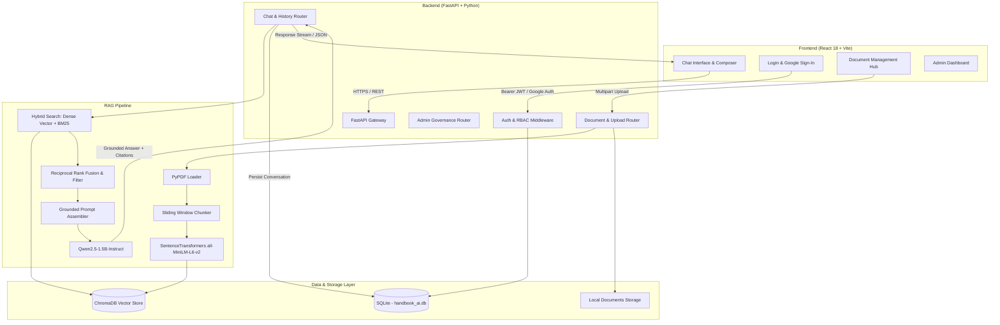

# Company Handbook Intelligence AI

> **Enterprise AI-powered company policy question answering using Retrieval-Augmented Generation (RAG) with page-level citations.**

[](https://www.python.org/)
[](https://fastapi.tiangolo.com/)
[](https://react.dev/)
[](https://www.trychroma.com/)
[](https://huggingface.co/sentence-transformers/all-MiniLM-L6-v2)
[](https://huggingface.co/Qwen/Qwen2.5-1.5B-Instruct)

---

## 📖 Table of Contents

1. [Project Overview](#-project-overview)
2. [Key Features](#-key-features)
3. [Screenshots & UI Showcase](#-screenshots--ui-showcase)
4. [System Architecture](#-system-architecture)
5. [RAG Pipeline Deep Dive](#-rag-pipeline-deep-dive)
6. [Technology Stack](#-technology-stack)
7. [Repository Structure](#-repository-structure)
8. [Installation & Local Setup](#-installation--local-setup)
9. [Configuration & Persistence](#-configuration--persistence)
10. [API Reference](#-api-reference)
11. [Testing & Verification](#-testing--verification)
12. [Security & Privacy](#-security--privacy)
13. [Limitations & Future Roadmap](#-limitations--future-roadmap)
14. [Demo Walkthrough](#-demo-walkthrough)
15. [License & Credits](#-license--credits)

---

## 🌟 Project Overview

Corporate employee handbooks are lengthy, dense PDF manuals containing crucial guidelines—such as annual leave allowances, carry-forward caps, remote work eligibility, travel per-diems, insurance claims, and probation rules. Employees often struggle to find answers quickly, leading to repetitive HR inquiries and outdated assumptions.

**Company Handbook Intelligence AI** solves this problem by transforming unsearchable handbook PDFs into an interactive enterprise AI conversational assistant. 

### Why RAG Instead of Raw Pretrained LLMs?
- **Zero Hallucinations on Specific Rules:** General-purpose LLMs do not know your organization's specific policies and will invent numbers or rules.
- **Verifiable Page-Level Citations:** Every answer cites the exact PDF page number and section, allowing employees and HR to verify policies immediately.
- **Data Privacy & Governance:** Company manuals are processed locally or within your private infrastructure rather than being trained into public models.
- **Dynamic Updates:** When policies change, HR administrators simply upload the updated PDF; ChromaDB indexes the new chunks instantly without model retraining.

---

## ✨ Key Features

- 📄 **Intelligent PDF Ingestion:** Page-accurate text extraction and normalization using PyPDF with sanitization against malformed content.
- ✂️ **Sliding-Window Semantic Chunking:** 1,000-character chunks with 150-character overlap that respect document section boundaries and preserve page metadata.
- 🔍 **Hybrid Retrieval Engine:** Combines dense semantic vector search (`sentence-transformers/all-MiniLM-L6-v2`) with lexical keyword search (BM25) for high recall and precision.
- 🎯 **Reciprocal Rank Fusion (RRF):** Fuses dense and sparse rankings with automatic filtering for table-of-contents noise, changelogs, and irrelevant pages.
- 🤖 **Grounded LLM Generation:** Strict anti-hallucination prompt guardrails powered by `Qwen/Qwen2.5-1.5B-Instruct` (with an intelligent fallback engine).
- 🏷️ **Interactive Page Citations:** Clickable citation pills (`PDF Page 49`, `PDF Page 70`) that open the **Citation Grounding Preview Modal** displaying the exact excerpt indexed from the handbook.
- 🔐 **Enterprise Authentication & RBAC:** Secure password hashing with `bcrypt` (12 rounds), signed JWT tokens, role enforcement (`Admin` vs. `Employee`), and **Google Sign-In** integration.
- 💬 **Conversation Session Persistence:** Full chat history stored in SQLite (WAL mode) with title auto-generation, search, renaming, and cross-user isolation (IDOR protection).
- 📚 **Documents & Knowledge Base Hub:** Upload, preview, download, and delete PDFs with real-time vector synchronization and status metrics.
- 📊 **Administrative Governance Dashboard:** Real-time analytics tracking active users, total documents, query frequency trends, and user role switching.
- ⭐ **User Feedback & Rating System:** 1–5 star rating with category selection and qualitative comments persisted to the database.

---

## 🖥️ Screenshots & UI Showcase

The application features an enterprise SaaS design system styled in modern dark and light tones (Orange, White, and Deep Charcoal).

| Screen | Description | Key Elements |
|---|---|---|
| **1. Split-Screen Sign-In** | Modern login & registration portal | Google Sign-In, 1-Click Demo Accounts, Form Validation |
| **2. AI Chat Workspace** | Central conversational interface | Fixed sidebar, hero state, starter policy cards, composer |
| **3. Grounded Policy Answer** | Structured response with citations | Numbered policy sections, interactive PDF citation badges |
| **4. Citation Grounding Preview** | Verification modal | Shows exact text chunk extracted from cited PDF page |
| **5. Documents Management** | Knowledge Base hub | Drag-and-drop PDF upload, chunk count stats, delete sync |
| **6. Admin Analytics** | Administrative dashboard | Platform metrics, user governance table, top user questions |
| **7. User Profile & Settings** | Account preferences | Profile updates, theme selection, password modification |

> **Note on Presentation Slides & Assets:**  
> Screen assets and visual presentation slides can be stored in `docs/assets/screenshots/`. Place your `.png` or `.webp` files in that folder to embed them in presentation decks or portfolio previews.

---

## 🏗️ System Architecture



---

## 🔬 RAG Pipeline Deep Dive

The retrieval-augmented generation engine follows an end-to-end grounded lifecycle:

1. **Document Ingestion:** The handbook PDF is processed page-by-page with `pypdf`, tracking physical page indices (1-indexed) and stripping unprintable artifacts.
2. **Chunking & Boundary Preservation:** Text is split using a sliding window of **1,000 characters** with a **150-character overlap**. Chunk boundaries preserve paragraph semantics and retain source page metadata.
3. **Dense Vector Embeddings:** Each chunk is converted into a 384-dimensional dense vector using `sentence-transformers/all-MiniLM-L6-v2`.
4. **Persistent Vector Indexing:** Embeddings and chunk payloads are indexed in persistent **ChromaDB** storage under the `company_handbook` collection.
5. **Query Normalization & Intent Detection:** Incoming user queries are parsed to extract keywords, identify intent (e.g., leave rules vs. insurance claims), and detect out-of-scope probes.
6. **Hybrid Dense + Sparse Search:**
   - **Dense Search:** Cosine similarity querying over ChromaDB vectors.
   - **Sparse Search:** Lexical keyword BM25 scoring over chunk tokens.
7. **Reciprocal Rank Fusion (RRF):** Dense and sparse scores are fused using rank reciprocal weighting. Noise heuristics actively filter out Table of Contents entries, revision changelogs, and document headers.
8. **Prompt Grounding Assembly:** Retrieved chunks are assembled into a structured system prompt that strictly commands the LLM to answer **only** using provided context and to cite page numbers.
9. **LLM Generation:** The prompt is processed by `Qwen/Qwen2.5-1.5B-Instruct` to formulate a concise, professional answer with page-level citations.
10. **Conversation History:** Queries, answers, citation metadata, and timestamps are recorded in SQLite for auditability and session resumption.

---

## 💻 Technology Stack

| Technology | Version / Specification | Role in the Project |
|---|---|---|
| **React** | `^18.3.1` | Single-Page Application (SPA) user interface and state management. |
| **Vite** | `^5.2.0` | Frontend dev server, hot module reloading (HMR), and optimized production bundler. |
| **FastAPI** | `>=0.110.0` | Asynchronous high-performance Python backend REST API gateway. |
| **Uvicorn** | `>=0.28.0` | High-performance ASGI production web server. |
| **Python** | `3.10` / `3.11` / `3.13` | Core backend runtime and RAG processing language. |
| **PyPDF** | `>=4.0.0` | PDF document parsing, page extraction, and text normalization. |
| **Sentence Transformers** | `>=2.6.0` | Local embedding generation using `all-MiniLM-L6-v2` (384-dim). |
| **ChromaDB** | `>=0.4.24` | Persistent on-disk vector database storing document chunks and embeddings. |
| **Transformers & PyTorch** | `>=4.38.0` / `>=2.2.0` | Deep learning runtime and model execution for `Qwen2.5-1.5B-Instruct`. |
| **BM25 & RRF** | Custom implementation | Lexical keyword retrieval combined with Reciprocal Rank Fusion. |
| **SQLite (WAL mode)** | Built-in | Relational database for users, sessions, chat history, documents, and audit logs. |
| **PyJWT & bcrypt** | `>=2.8.0` / `>=4.0.0` | Cryptographic JWT token generation/validation and salted password hashing. |
| **Pytest & HTTPX** | `>=8.0.0` / `>=0.27.0` | Automated test runner, integration tests, and asynchronous API client testing. |
| **Vanilla CSS** | Modern CSS variables | Responsive enterprise SaaS styling (Orange, White, Dark Charcoal). |

---

## 📁 Repository Structure

```
Company Handbook Intelligence AI/
├── backend/
│   ├── main.py                     # FastAPI entrypoint, lifespan events, and CORS
│   ├── api/
│   │   ├── auth_routes.py          # Sign in, registration, Google SSO, session
│   │   ├── chat_routes.py          # Conversational querying, history, and IDOR checks
│   │   ├── document_routes.py      # PDF upload, document purge, metadata metrics
│   │   ├── admin_routes.py         # Admin governance, metrics, and user management
│   │   ├── settings_routes.py      # Profile updates and password management
│   │   ├── feedback_routes.py      # Rating and feedback submission
│   │   └── routes.py               # Core & legacy endpoints (/health, /ask, /upload)
│   ├── auth/
│   │   └── security.py             # Password hashing (bcrypt) and JWT verification
│   ├── chunking/
│   │   └── chunker.py              # 1,000-char sliding window chunker
│   ├── db/
│   │   └── database.py             # SQLite schema initialization & demo account seeding
│   ├── embeddings/
│   │   └── embedder.py             # SentenceTransformers all-MiniLM-L6-v2 singleton
│   ├── ingestion/
│   │   └── loader.py               # PyPDF page-by-page extraction
│   ├── llm/
│   │   └── llm_client.py           # Grounded response generator & Qwen model loader
│   ├── prompts/
│   │   └── prompt_templates.py     # Grounded anti-hallucination prompt definitions
│   ├── retrieval/
│   │   ├── query_parser.py         # Query normalization and entity extraction
│   │   └── retriever.py            # Hybrid BM25 + ChromaDB dense retrieval with RRF
│   ├── utils/
│   │   └── helpers.py              # Configuration parsing and directory utilities
│   └── vectordb/
│       └── vector_store.py         # Persistent ChromaDB store interface
├── frontend/
│   ├── src/
│   │   ├── App.jsx                 # Central React container and view router
│   │   ├── App.css                 # Comprehensive SaaS design system
│   │   ├── main.jsx                # React DOM mounting
│   │   └── components/             # 19 modular React UI components
│   ├── public/                     # Static assets and SPA routing redirects
│   ├── package.json                # Frontend dependencies and build scripts
│   ├── vite.config.js              # Vite configuration
│   └── .env.production.example     # Production frontend configuration template
├── tests/
│   ├── test_api.py                 # Core API endpoints test
│   ├── test_api_qa.py              # Security, RBAC, IDOR, and injection audit tests
│   ├── test_app.py                 # Prompt assembly and fallback tests
│   ├── test_e2e_rag.py             # End-to-end PDF indexing and persistence test
│   ├── test_e2e_workflow.py        # Full user journey (register, upload, query, purge)
│   ├── test_evaluation_suite.py    # 10 policy accuracy and retrieval precision benchmarks
│   ├── test_handbook_regression.py # 8 Atos Handbook policy regression benchmarks
│   ├── test_ingestion.py           # Chunker and loader unit tests
│   ├── test_retrieval.py           # Vector database persistence tests
│   └── test_synthetic_travel_policy.pdf # Non-sensitive synthetic test fixture
├── config.yaml                     # Application hyperparameters and paths
├── requirements.txt                # Backend Python package manifest
├── .env.example                    # Environment template with placeholder secrets
├── .gitignore                      # Git exclusion rules (safeguards secrets & DBs)
├── netlify.toml                    # Netlify production configuration & CSP headers
└── README.md                       # Project landing page
```

---

## 🚀 Installation & Local Setup

### 1. Prerequisites
- **Python:** `3.10`, `3.11`, or `3.13`
- **Node.js:** `18.x` or later (with `npm`)
- **Git**

### 2. Clone the Repository
```bash
git clone https://github.com/dhandabani7966/company-handbook-rag-chatbot.git
cd company-handbook-rag-chatbot
```

### 3. Backend Setup
```bash
# 1. Create and activate a Python virtual environment
# Windows (PowerShell):
python -m venv .venv
.\.venv\Scripts\Activate.ps1

# Linux / macOS:
python3 -m venv .venv
source .venv/bin/activate

# 2. Install Python dependencies
pip install -r requirements.txt

# 3. Configure environment variables
# Copy the example environment file:
cp .env.example .env
```

> **Security Note:** In production, generate a secure 32-character hex secret for `JWT_SECRET_KEY` using:  
> `python -c "import secrets; print(secrets.token_hex(32))"`

### 4. Frontend Setup
```bash
cd frontend
npm install
cd ..
```

### 5. Running the Application Locally
Run the backend and frontend in two separate terminals:

```bash
# Terminal 1 — Start the FastAPI Backend Server
uvicorn backend.main:app --host 127.0.0.1 --port 8000 --reload
```
- **Health Check:** [http://127.0.0.1:8000/health](http://127.0.0.1:8000/health)
- **Interactive Swagger Docs:** [http://127.0.0.1:8000/docs](http://127.0.0.1:8000/docs)

```bash
# Terminal 2 — Start the React + Vite Frontend Server
cd frontend
npm run dev -- --host 127.0.0.1 --port 5173
```
- **Web Application URL:** [http://127.0.0.1:5173/](http://127.0.0.1:5173/)

---

## ⚙️ Configuration & Persistence

### Environment Variables (`.env`)

| Variable | Default Value | Description |
|---|---|---|
| `HOST` | `127.0.0.1` | Backend network bind host. |
| `PORT` | `8000` | Backend network port. |
| `ENVIRONMENT` | `development` | Set to `production` in production mode to enforce strict JWT keys. |
| `JWT_SECRET_KEY` | *(Ephemeral in dev)* | Secret key for signing session tokens (min 32 characters in production). |
| `DOCUMENTS_DIR` | `data/documents` | Storage folder for uploaded PDF handbooks. |
| `CHROMA_DB_DIR` | `data/chroma_db` | Storage folder for persistent ChromaDB vector data. |
| `COLLECTION_NAME` | `company_handbook` | ChromaDB collection name. |
| `EMBEDDING_MODEL_NAME` | `sentence-transformers/all-MiniLM-L6-v2` | Embedding model identifier. |
| `LLM_MODEL_NAME` | `Qwen/Qwen2.5-1.5B-Instruct` | Local Hugging Face LLM model identifier. |

### Automatic Database Initialization & Seeding
On first startup, the backend automatically initializes:
- `data/handbook_ai.db` with users, sessions, documents, settings, feedback, and audit log tables.
- Default administrator account: `admin@company.com` (`Admin@12345`).
- Default employee account: `abhishek@company.com` (`Abhishek@123`).
- Storage directories `data/documents/` and `data/chroma_db/`.

---

## 📡 API Reference

### Authentication Endpoints
| Method | Endpoint | Description | Auth Required |
|---|---|---|---|
| `POST` | `/api/auth/register` | Register a new user account. | No |
| `POST` | `/api/auth/login` | Authenticate with email/password and receive a JWT. | No |
| `POST` | `/api/auth/google` | Authenticate or auto-register with Google Sign-In. | No |
| `GET` | `/api/auth/me` | Fetch authenticated user profile. | Bearer JWT |
| `POST` | `/api/auth/logout` | Terminate session and audit logout. | Bearer JWT |

### RAG & Chat Endpoints
| Method | Endpoint | Description | Auth Required |
|---|---|---|---|
| `POST` | `/api/chat` | Submit a question and receive grounded answer + citations. | Bearer JWT |
| `GET` | `/api/chat/conversations` | List conversation sessions for the authenticated user. | Bearer JWT |
| `GET` | `/api/chat/conversations/{id}` | Retrieve messages for a specific conversation session. | Bearer JWT |
| `DELETE` | `/api/chat/conversations/{id}`| Delete a conversation session. | Bearer JWT |
| `POST` | `/ask` | Legacy backward-compatible RAG endpoint. | Optional |

### Document Management Endpoints
| Method | Endpoint | Description | Auth Required |
|---|---|---|---|
| `GET` | `/api/documents` | List indexed PDF documents and chunk statistics. | Bearer JWT |
| `POST` | `/api/documents/upload` | Upload and chunk an employee handbook PDF. | Bearer JWT |
| `DELETE` | `/api/documents/{id}` | Delete a document and purge its ChromaDB vector chunks. | Bearer JWT |
| `POST` | `/upload` | Legacy backward-compatible multipart upload endpoint. | Optional |

### Administration & System Endpoints
| Method | Endpoint | Description | Auth Required |
|---|---|---|---|
| `GET` | `/api/admin/metrics` | Retrieve platform analytics and query frequencies. | Admin Only |
| `GET` | `/api/admin/users` | List all registered users. | Admin Only |
| `PUT` | `/api/admin/users/{id}/role` | Promote or demote user roles. | Admin Only |
| `POST` | `/api/feedback` | Submit 1–5 star rating and category feedback. | Bearer JWT |
| `GET` | `/health` | Server health check and ChromaDB chunk count. | No |

---

## 🧪 Testing & Verification

The project includes an automated test suite verifying unit functionality, security boundaries, RAG accuracy, and end-to-end workflows.

### Running Backend Tests
```bash
# Run the complete test suite (53 tests)
pytest tests/ -v
```

### Verified Test Suite Breakdown
- **Core API Tests (`tests/test_api.py`):** 3 passed  
  *Validates `/health`, invalid upload rejection, and query validation.*
- **Security & QA Tests (`tests/test_api_qa.py`):** 24 passed  
  *Validates password hashing, JWT signing, RBAC role enforcement, cross-user IDOR isolation, SQL injection prevention, XSS escaping, path traversal defense, and prompt injection resistance.*
- **Prompt & App Logic (`tests/test_app.py`):** 2 passed  
  *Validates grounded prompt formatting and empty-source fallbacks.*
- **Vector Ingestion & Persistence (`tests/test_ingestion.py`, `tests/test_retrieval.py`):** 4 passed  
  *Validates 1,000-character chunking, page number preservation, and ChromaDB persistence.*
- **RAG Policy Evaluation Suite (`tests/test_evaluation_suite.py`):** 10 passed  
  *Validates precision and ground-truth claims across 10 distinct handbook policy scenarios.*
- **Handbook Policy Regression Suite (`tests/test_handbook_regression.py`):** 8 passed  
  *Validates core entitlements: 22 annual leave days (Page 49), privilege leave accumulation up to 25 days (Pages 49–50), and remote work broadband guidelines (Page 70).*
- **Full Production Workflow (`tests/test_e2e_workflow.py`):** 1 passed  
  *Executes an end-to-end test including user registration, synthetic PDF upload, hybrid search, citations, IDOR checks, and document cleanup.*

### Running Frontend Production Build
```bash
cd frontend
npm run build
```
- **Result:** Builds cleanly in ~2 seconds (0 errors, 0 warnings).

---

## 🛡️ Security & Privacy

- **No Secret Leaks:** `.env`, local SQLite databases (`*.db`), persistent ChromaDB files, and proprietary PDFs in `data/documents/` are excluded by `.gitignore`.
- **Password Security:** Passwords are never stored in plaintext; hashed using `bcrypt` with 12 salt rounds.
- **Strict Production JWT Enforcement:** In production mode, startup is aborted if `JWT_SECRET_KEY` is missing, shorter than 32 characters, or set to a placeholder string.
- **Role-Based Access Control (RBAC):** Administrative endpoints require `role: admin`. Employees attempting to access admin routes receive `HTTP 403 Forbidden`.
- **Object-Level Access Control (IDOR):** Chat sessions and document operations are scoped strictly to the authenticated user ID; users cannot access or delete other users' chat histories.
- **Input Sanitization & Injection Defense:**
  - SQL queries are fully parameterized.
  - File uploads validate extensions, enforce size limits, and strip path-traversal characters (`../`).
  - System prompts use strict role delimiters and defensive instructions to mitigate prompt injection attacks.
- **Deployment Security Headers:** Netlify configuration includes HSTS, Clickjacking protection (`X-Frame-Options: DENY`), MIME sniffing protection, and Content Security Policy (CSP).

---

## ⚠️ Limitations & Future Roadmap

### Current Limitations
1. **Scanned / Image PDFs:** PyPDF extracts text-based PDFs. Non-OCR scanned images require a separate OCR pipeline.
2. **Local LLM Hardware Requirements:** Running `Qwen2.5-1.5B-Instruct` locally in high concurrency benefits from a modern multi-core CPU or GPU with 4GB+ VRAM.
3. **Single Vector Collection:** Current vector indexing groups chunks into a central collection per handbook rather than multi-tenant tenant isolation.

### Future Improvements
- [ ] **OCR Preprocessing:** Integrate Tesseract / EasyOCR for scanned document support.
- [ ] **Token-by-Token Streaming:** Implement Server-Sent Events (SSE) or WebSockets for real-time response streaming in the chat composer.
- [ ] **Visual PDF Page Viewer:** Render highlighted bounding boxes directly on the PDF page in the grounding preview modal.
- [ ] **Cloud Vector Database Adapter:** Add support for Qdrant / Pinecone for distributed enterprise deployments.
- [ ] **Multi-Handbook Switching:** Allow employees to select between HR, IT Security, and Compliance handbooks via a workspace dropdown.

---

## 🎬 Demo Walkthrough

1. **Sign In:** Open [http://127.0.0.1:5173/](http://127.0.0.1:5173/) and click **Admin (admin@company.com)** or **Sign in with Google**.
2. **Ask a Policy Question:** In the chat input, ask:
   > *"What is the annual leave entitlement and maximum privilege leave carry forward?"*
3. **Inspect the Answer:** The AI responds with structured bullet points citing:
   - `Annual Leave:` 22 working days per calendar year.
   - `Carry Forward:` Maximum of 10 days carry forward per year, total accumulation capped at 25 days.
4. **Verify Grounding:** Click on the red citation pill **PDF Page 49** or **PDF Page 50** to inspect the exact excerpt indexed from the handbook in the **Citation Grounding Preview Modal**.
5. **Manage Documents:** Navigate to **Documents & Knowledge Base** to upload new company policies or delete outdated manuals.
6. **Governance:** Switch to the **Admin Dashboard** to inspect query analytics and user accounts.

---

## 📄 License & Credits

- **Repository:** [https://github.com/dhandabani7966/company-handbook-rag-chatbot](https://github.com/dhandabani7966/company-handbook-rag-chatbot)
- **Author & Maintainer:** [dhandabani7966](https://github.com/dhandabani7966)
- **Frameworks & Models:** Built with [FastAPI](https://fastapi.tiangolo.com/), [React](https://react.dev/), [ChromaDB](https://www.trychroma.com/), [Sentence Transformers](https://sbert.net/), and [Qwen2.5](https://huggingface.co/Qwen).
